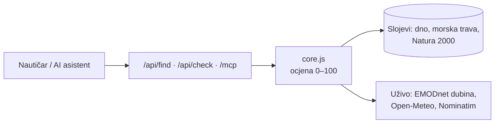

# Sigurno sidrište

Gdje sidriti na hrvatskom Jadranu. Upiši mjesto (npr. *Pakleni otoci*), pritisni **Pronađi sidrište u blizini** i dobiješ do 5 najboljih mjesta s dubinom, vrstom dna, zaklonom i duljinom lanca. Ili dodirni more na karti za provjeru jedne točke.

**Uživo za testiranje:** https://sigurno-sidriste.vercel.app · MCP: `https://sigurno-sidriste.vercel.app/mcp` · API: [`/openapi.json`](https://sigurno-sidriste.vercel.app/openapi.json)

**Dokumentacija:** [tehnička arhitektura, izvori i licence, preduvjeti, integracija](docs/ARHITEKTURA.md) · [OpenAPI opis API-ja](web/openapi.json)

Isto znanje dostupno je i AI asistentima preko **MCP servera**, pa nautičar može samo pitati:
> *"Gdje mogu sidriti večeras kod Visa, puše jugo?"*

## Što se provjerava

| Provjera | Izvor | Kako se koristi |
|---|---|---|
| Koliko dno drži | EMODnet Geology 1:250k, rupe popunjene s 1:1M | pijesak odlično, mulj dobro, šljunak osrednje, stijene loše |
| Livade morske trave | EMODnet Seabed Habitats 2025 (UNEP-WCMC, HAOP) | kartirana posidonija / čvorasta morska resa → **ne sidri** |
| Moguća posidonija | EUSeaMap 2025 infralitoral + hrvatska Art. 17 mreža | upozorenje: spusti sidro na svijetli pijesak |
| Dubina | EMODnet Bathymetry (uživo) | 3–15 m idealno, >35 m preduboko |
| Zaklon | EMODnet profili dubine u 8 smjerova (uživo) | kopno unutar 1,5 km u smjeru najjačeg vjetra idućih 12 h |
| Vjetar, udari, valovi | Open-Meteo (uživo) | hrvatski nazivi vjetrova (bura, jugo, maestral…) |
| Zaštićena područja | Bioportal Natura 2000 (ptice) | informativno |
| Mjesta | OpenStreetMap Nominatim | "Hvar" → koordinate |

Pomoć pri planiranju, ne navigacijska karta. Licence i uvjeti svakog izvora: [docs/ARHITEKTURA.md](docs/ARHITEKTURA.md#4-izvori-podataka-i-licence).

## Kako radi



Ocjena je pravilo s bodovima, pa svaka presuda dolazi s objašnjenjem. Detalji pravila: [docs/ARHITEKTURA.md](docs/ARHITEKTURA.md#3-algoritam-ocjene).

## API

```bash
curl "https://sigurno-sidriste.vercel.app/api/find?q=Telašćica&r=3"     # do 5 sidrišta u blizini
curl "https://sigurno-sidriste.vercel.app/api/check?lat=43.174&lon=16.3249"  # ocjena jedne točke
curl "https://sigurno-sidriste.vercel.app/api/geocode?q=Hvar"            # naziv → koordinate
```

Puni opis parametara i odgovora: [web/openapi.json](web/openapi.json) (OpenAPI 3.1, javno na `/openapi.json`).

## Pokretanje

```bash
npm install
npm run data     # jednom: preuzmi i pripremi slojeve (Python 3 + Node)
npm start        # http://localhost:5173  ·  MCP: http://localhost:5173/mcp
```

## MCP

Dva alata: `pronadi_sidriste` (mjesto ili lat/lon, polumjer) i `provjeri_tocku` (mjesto ili lat/lon).

**Claude Code** - već je podešeno u `.mcp.json`, samo otvori projekt.

**Claude Desktop** - dodaj u `~/Library/Application Support/Claude/claude_desktop_config.json`:

```json
{
  "mcpServers": {
    "sigurno-sidriste": {
      "command": "node",
      "args": ["/PUNA/PUTANJA/DO/OKOLIS/mcp/stdio.js"]
    }
  }
}
```

**Udaljeno (ChatGPT, Claude.ai konektori)** - dodaj `https://sigurno-sidriste.vercel.app/mcp` kao prilagođeni konektor.

## Objava

Vercel projekt `sigurno-sidriste` povezan je s GitHub repozitorijem: svaki push na `main` automatski se objavljuje. Statične datoteke su u `web/`, a `api/*.js` su Vercel funkcije (`/mcp` se preusmjerava na `api/mcp.js`).

## Struktura

- `web/core.js` - sva logika (ocjena, pretraga, zaklon, geokodiranje), dijele je web i MCP
- `web/index.html`, `web/app.js`, `web/style.css` - sučelje (Leaflet)
- `server/handlers.js` - API i MCP rukovatelji (ograničavaju i pamte pozive prema EMODnetu)
- `server/index.js` - lokalni server: web + `/api/*` + `/mcp` · `api/*.js` - iste rute kao Vercel funkcije
- `mcp/tools.js` - definicije MCP alata · `mcp/stdio.js` - stdio ulaz
- `scripts/download_data.py`, `scripts/build_layers.py` - priprema podataka (~31 MB → ~1,3 MB)
- `web/openapi.json` - OpenAPI opis API-ja · `docs/ARHITEKTURA.md` - arhitektura, izvori, licence, preduvjeti

## Licenca

Kod: [MIT](LICENSE). Podaci zadržavaju licence svojih izvora (EMODnet CC BY 4.0, OpenStreetMap ODbL, Open-Meteo CC BY 4.0, Bioportal) - vidi [docs/ARHITEKTURA.md](docs/ARHITEKTURA.md#4-izvori-podataka-i-licence).
