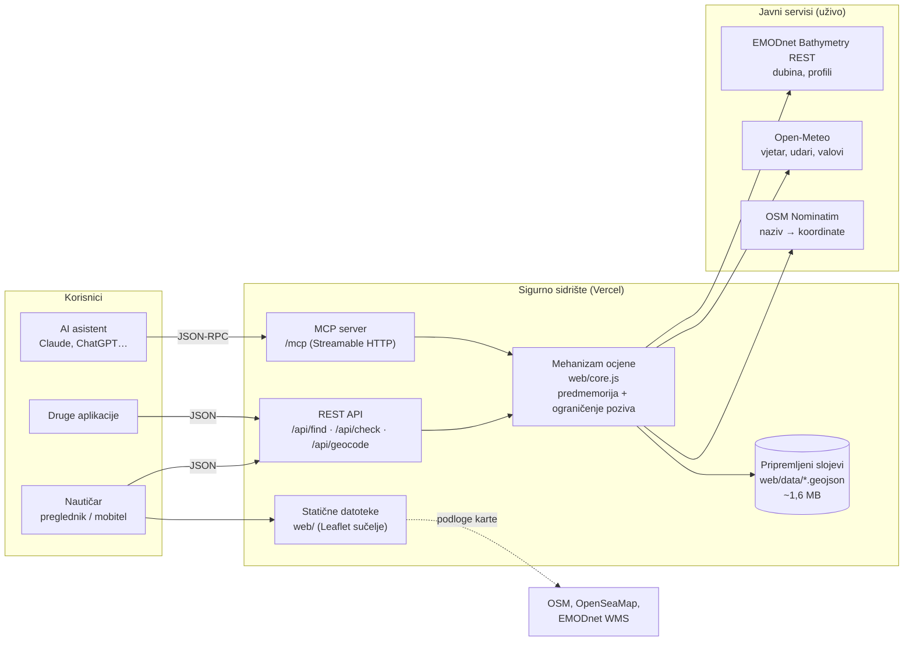
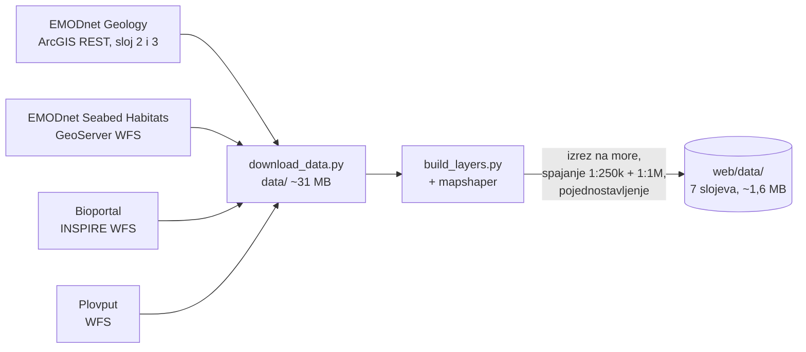
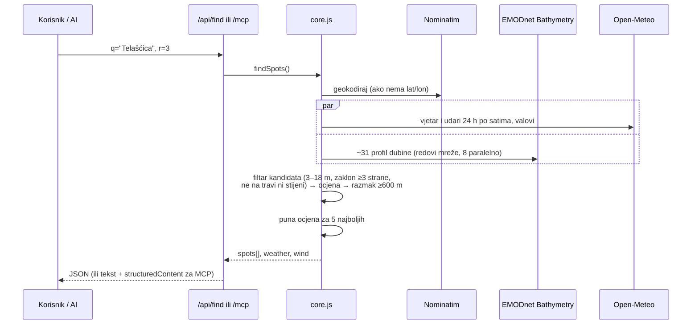

# Tehnička arhitektura

Sigurno sidrište spaja pet javnih izvora podataka u jednu odluku: *smijem li ovdje sidriti i koliko lanca trebam*. Isti mehanizam ocjene (`web/core.js`) koriste web aplikacija, REST API i MCP server za AI asistente.

## 1. Komponente

| Dio | Datoteke | Uloga |
|---|---|---|
| Sučelje | `web/index.html`, `web/app.js`, `web/style.css` | Karta (Leaflet), pretraga, popis sidrišta, detalji; mobilni prikaz kao donji izbornik |
| Mehanizam ocjene | `web/core.js` | Ocjena točke, pretraga mreže, zaklon, geokodiranje. Radi u Nodeu i u pregledniku |
| HTTP rukovatelji | `server/handlers.js`, `server/engine.js` | Provjera ulaza, API i MCP; učitava slojeve s diska |
| Vercel funkcije | `api/find.js`, `api/check.js`, `api/geocode.js`, `api/mcp.js` | Tanki omotači oko `handlers.js` |
| Lokalni server | `server/index.js` | Isto što i Vercel, na `localhost:5173` |
| MCP | `mcp/tools.js`, `mcp/stdio.js` | Alati `pronadi_sidriste` i `provjeri_tocku`; stdio i HTTP |
| Priprema podataka | `scripts/download_data.py`, `scripts/build_layers.py` | Preuzimanje i obrada slojeva (jednom, ne pri svakom zahtjevu) |

## 2. Tok podataka

### Priprema (jednom, `npm run data`)

1. **Dno:** karta 1:250k je glavna. Gdje ona ne pokriva (unutarnje uvale), rupe popunjava karta 1:1M. Folk-5 klase se prevode u ocjenu držanja 0–3.
2. **Morska trava, posidonija, biološke zone, Natura 2000 i zaštićena područja** izrezuju se na hrvatsko more. Zadržavaju se samo zaštićena područja kojima je barem 10 % površine u moru.
3. **Plovputove oznake**: zadržavaju se aktivne, a oznake podvodne opasnosti (kardinalne, usamljena opasnost, nazivi „Pličina“, „Sika“, „Hrid“…) posebno se označavaju.
4. Rezultat je 7 GeoJSON datoteka koje se poslužuju statično i učitavaju u memoriju funkcije.

### Zahtjev „Pronađi sidrište“

## 3. Algoritam ocjene

Ocjena je pravilo s bodovima (0–100). Nije strojno učenje, pa je svaki rezultat moguće objasniti, a svaka činjenica u odgovoru ima svoje objašnjenje.

| Provjera | Izvor | Pravilo |
|---|---|---|
| Dno | EMODnet Geology | Početna ocjena: pijesak 100, mulj i miješano 82, šljunak 55, stijene 20 |
| Morska trava | EMODnet Seabed Habitats | Kartirana livada → **„Ne sidri ovdje“** (ocjena najviše 10). Infralitoral bez karte → −8 i upozorenje |
| Dubina | EMODnet Bathymetry | <2 m blokira; 2–3 m −12; 15–25 m −22; 25–35 m −35; >35 m blokira. Bez izmjere koristi se izglađena procjena (označena s ≈) |
| Vjetar | Open-Meteo, 24 h po satima | Udari ≥20 čv ili ≥25 čv u idućih 24 h → −12 (u zaklonu −5); ≥30/35 čv → −30 (u zaklonu −10) |
| Valovi | Open-Meteo Marine | ≥0,8 m −5; ≥1,5 m −15; bez kazne ako je uvala zaklonjena od smjera vjetra |
| Zaklon | Profili dubine u 8 smjerova, 2 km | Kopno unutar 1,5 km = zaklon s te strane. Otvoreno prema najjačem vjetru idućih 24 h: −20 (udari ≥15 čv) ili −30 (≥25 čv); otvoreno prema olujnom vjetru (≥34 čv) → **„Ne sidri ovdje“** |
| Zaštićeno područje | Zaštićena područja RH (data.gov.hr) | Nacionalni park −10, posebni/strogi rezervat −15, park prirode −5, ostalo 0; uvijek s pravilima koja treba provjeriti |
| Oznaka opasnosti | Plovput (data.gov.hr) | Oznaka podvodne opasnosti unutar 400 m → −8 i upozorenje s udaljenošću i smjerom |
| Natura 2000 | Natura 2000 (data.gov.hr) | Samo informacija, bez bodova |
| Lanac | izračun | (dubina + 1,5 m) × 5, ili × 7 kad puše |
| Gaz broda (neobavezno) | korisnik | Dubina < gaz + 1 m blokira („Preplitko za tvoj brod“); < gaz + 2 m → −12 |
| Lanac broda (neobavezno) | korisnik | Manje od potrebnog, ali barem 4:1 → −10 („samo za mirno vrijeme“); manje od 4:1 → −30 |
| Krug okretanja (neobavezno) | duljina broda + zrake zaklona | Vodoravni dio lanca + duljina broda veći od udaljenosti do kopna → −10 |

Ako korisnik upiše brod, pretraga traži dubine od gaz + 1,5 m do lanac / 4 − 1,5 m (najviše 18 m). Podaci o brodu spremaju se samo u pregledniku korisnika (`localStorage`). GPS položaj koristi se samo za središte pretrage te za udaljenost i smjer do sidrišta, a server ga ne sprema.

**Način rada za loše vrijeme.** Kad udari u idućih 24 h dosegnu 25 čv (jak vjetar) ili 34 čv (olujni), odgovor nosi upozorenje (`alert`: vjetar, smjer, jačina, sat). Pretraga tada vraća samo mjesta s kopnom unutar 1,5 km s barem dvije od tri strane iz kojih vjetar dolazi. Ako takvih nema u zadanom krugu, krug se jednom proširuje na 7 km, a ako ih ni tada nema, savjetuje se luka ili marina. Sučelje prikazuje upozorenje i udare po 3 sata za idućih 24 h. Za testiranje i demonstraciju postoji simulirana prognoza (`?sim=bura` ili `?sim=jugo`), jasno označena u odgovoru i u sučelju.

Presuda: ≥70 „Dobro mjesto“, 45–69 „Sidri uz oprez“, <45 „Loše mjesto“, a blokada daje „Ne sidri ovdje“.

## 4. Izvori podataka i licence

Svi korišteni skupovi podataka, njihovi izdavatelji i poveznice na izvore. **Tri skupa objavljena su na Portalu otvorenih podataka (data.gov.hr).**

### S Portala otvorenih podataka (data.gov.hr)

| Skup podataka | Izdavatelj | Portal | Servis (pristup) | Licenca | Čemu služi |
|---|---|---|---|---|---|
| Zaštićena područja Republike Hrvatske – INSPIRE | Ministarstvo zaštite okoliša i zelene tranzicije (Bioportal); katalogizira Državna geodetska uprava | [data.gov.hr](https://data.gov.hr/ckan/dataset/zatiena-podruja-republike-hrvatske-inspire) | [WFS `ps1:ProtectedSite`](https://services.bioportal.hr/inspire/geos1/ps/wfs?service=WFS&version=2.0.0&request=GetCapabilities), preuzeto | Javni INSPIRE servis, „nema ograničenja“ pristupa (GetCapabilities) | Nacionalni parkovi, parkovi prirode i rezervati u moru: upozorenje na pravila sidrenja |
| Ekološka mreža Natura 2000 Republike Hrvatske – INSPIRE | isto | [data.gov.hr](https://data.gov.hr/ckan/dataset/ekoloka-mrea-natura-2000-republike-hrvatske-inspire) | [WFS `ps2:ProtectedSite`](https://services.bioportal.hr/inspire/geos2/ps/wfs?service=WFS&version=2.0.0&request=GetCapabilities), preuzeto | isto | Područja očuvanja za ptice: informacija u ocjeni |
| Registar objekata sigurnosti plovidbe | Plovput d.o.o. Split | [data.gov.hr](https://data.gov.hr/ckan/dataset/registar-objekata-sigurnosti-plovidbe) | [WFS `RospObjekti`](https://rosp.plovput.hr/plovput_ows/ows?service=wfs&request=GetCapabilities), preuzeto | Otvorena dozvola (OD) | Svjetionici i oznake; upozorenje kad je oznaka podvodne opasnosti unutar 400 m |

### Europski i drugi javni izvori

| Skup podataka | Izdavatelj | Izvor | Pristup | Licenca | Čemu služi |
|---|---|---|---|---|---|
| Seabed substrate 1:250k i 1:1M (Folk) | EMODnet Geology (EU, GTK) | [emodnet.ec.europa.eu/en/geology](https://emodnet.ec.europa.eu/en/geology) · [ArcGIS REST](https://gtkdata.gtk.fi/arcgis/rest/services/EMODnet/EMODnet_Geology/MapServer) | preuzeto | CC BY 4.0 | Vrsta dna i koliko sidro drži |
| Seagrass cover 2025, Art. 17 stanište 1120 (Posidonia), EUSeaMap 2025 biološke zone | EMODnet Seabed Habitats (EU); izvorni podaci UNEP-WCMC i države članice | [emodnet.ec.europa.eu/en/seabed-habitats](https://emodnet.ec.europa.eu/en/seabed-habitats) · [WFS](https://ows.emodnet-seabedhabitats.eu/geoserver/emodnet_view/wfs?service=WFS&request=GetCapabilities) | preuzeto | CC BY 4.0, uz navođenje izvornih nositelja | Livade posidonije (zabrana) i plitko dno gdje može rasti |
| Digital Terrain Model – dubina i profili | EMODnet Bathymetry (EU) | [emodnet.ec.europa.eu/en/bathymetry](https://emodnet.ec.europa.eu/en/bathymetry) · [REST](https://rest.emodnet-bathymetry.eu) · [WMS](https://ows.emodnet-bathymetry.eu/wms) | uživo | CC BY 4.0 | Dubina, zaklon u 8 smjerova, sjenčanje karte |
| Prognoza vjetra i valova | Open-Meteo (modeli nacionalnih meteoroloških službi) | [open-meteo.com](https://open-meteo.com/en/docs/marine-weather-api) · [licenca](https://open-meteo.com/en/licence) | uživo | Podaci CC BY 4.0; besplatni API za nekomercijalnu uporabu | Vjetar i udari idućih 24 h, upozorenje na jak vjetar, valovi |
| Nominatim | OpenStreetMap Foundation | [API](https://nominatim.org/release-docs/latest/api/Search/) · [pravila](https://operations.osmfoundation.org/policies/nominatim/) | uživo | ODbL; najviše 1 zahtjev u sekundi | Naziv mjesta u koordinate |
| Podloga karte | OpenStreetMap, OpenSeaMap | [osm.org/copyright](https://www.openstreetmap.org/copyright) · [openseamap.org](https://www.openseamap.org) | XYZ pločice | ODbL / CC BY-SA | Karta i pomorski simboli |

Atribucija izvora prikazana je u aplikaciji (na karti i ispod detalja svakog mjesta) i u README-u.

### Softver i alati

- Biblioteke otvorenog koda: Leaflet (BSD-2-Clause), Turf (MIT), Model Context Protocol SDK (MIT), zod (MIT), mapshaper (MPL-2.0), Playwright (Apache-2.0, samo za snimanje videa).
- **Korištenje umjetne inteligencije u izradi:** dio koda, dokumentacije i skripte za video izrađen je uz pomoć AI asistenta za programiranje **Claude Code** (Anthropic, model Claude Opus). Tim je odredio ideju, zahtjeve i izbor podataka, pregledao i testirao rezultate te odgovara za rješenje. Naracija u videu sintetizirana je glasom „Lana“ iz macOS-a.

## 5. Standardi i interoperabilnost

- **Ulaz:** OGC WFS 1.0/2.0, OGC WMS, ArcGIS REST, INSPIRE (Protected Sites), REST/JSON.
- **Izlaz:** GeoJSON (RFC 7946, WGS84) za slojeve; REST/JSON API opisan u [OpenAPI 3.1](../web/openapi.json) (javno na `/openapi.json`); **Model Context Protocol** (JSON-RPC 2.0 preko Streamable HTTP ili stdio) za AI asistente.
- **Koordinate:** EPSG:4326 svugdje.
- **Jezik:** sav sadržaj odgovora je na hrvatskom; kodovi (`lvl`, `id`) su stabilni i neovisni o jeziku, pa se sučelje može prevesti bez promjene API-ja.

## 6. Integracija s postojećim sustavima

Zahvaljujući REST API-ju i OpenAPI opisu, rješenje se bez promjena može ugraditi u druge aplikacije. Uz razumne prilagodbe moguće je i sljedeće:

| Sustav | Što donosi | Prilagodba |
|---|---|---|
| Hrvatski hidrografski institut (HHI) – službene karte i batimetrija | Preciznija dubina uz obalu od EMODnet mreže (~115 m) | Novi izvor u `depthAt()`; potreban sporazum o korištenju podataka |
| DHMZ – pomorska prognoza i upozorenja | Službena upozorenja za buru i jugo | Dodatna činjenica u `assess()` |
| Javne ustanove parkova i županije – koncesionirana sidrišta, polja plutača, zone zabrane sidrenja | Lokalna pravila i plutače kao preporuka umjesto sidrenja | Novi GeoJSON sloj u `scripts/` i provjera u `assess()` |
| Portal otvorenih podataka (data.gov.hr) | Objava pripremljenih slojeva kao otvorenog skupa podataka | Slojevi su već u GeoJSON formatu |
| Charter i nautičke aplikacije | Provjera sidrišta unutar postojeće aplikacije | Poziv `/api/check` ili `/api/find` |
| AI asistenti | Pitanja prirodnim jezikom | Već radi preko `/mcp` |

## 7. Preduvjeti

**Tehnički**
- Node.js ≥ 20; Python 3.8+ i `npx mapshaper` samo za pripremu podataka.
- Bez baze podataka i bez tajnih ključeva: svi izvori su otvoreni.
- Hosting: bilo koji Node server ili serverless platforma (trenutno Vercel, funkcije do 60 s).
- Za veći promet: zajednička predmemorija (npr. Redis) umjesto memorije pojedine instance, vlastita Nominatim instanca ili komercijalni geokoder, komercijalni Open-Meteo plan.

**Organizacijski**
- Vlasnik koji održava aplikaciju i jednom godišnje osvježava slojeve (EMODnet izlazi s novim izdanjima).
- Stručna provjera pravila ocjene s nautičarima i morskim biolozima (npr. udruga Sunce, JU parkova).
- Kanal za prijavu pogrešaka u podacima (npr. neoznačena livada posidonije).

**Pravni**
- Atribucija izvora prema CC BY 4.0, ODbL i CC BY-SA (već prikazana).
- Potvrda uvjeta ponovne uporabe podataka s Bioportala (zaštićena područja, Natura 2000): na data.gov.hr nemaju navedenu licencu, a servis navodi da nema ograničenja pristupa.
- Navođenje korištenja AI alata u izradi (vidi „Softver i alati“).
- Komercijalna uporaba zahtijeva plaćeni Open-Meteo plan i drugi geokoder.
- Izjava o odricanju odgovornosti: aplikacija je pomoć pri planiranju, ne zamjenjuje službene pomorske karte, dubinomjer ni lokalna pravila.
- Privatnost: aplikacija ne traži prijavu, ne sprema osobne podatke ni lokacije korisnika i ne koristi kolačiće za praćenje.
- Kod projekta je pod licencom MIT ([LICENSE](../LICENSE)); licence izvora podataka vrijede neovisno o njoj.

## 8. Ograničenja

- Prva pretraga u novom području traje 8–15 s (dubine se mjere uživo); ponovljena je brza dok je instanca aktivna.
- Ovisnost o dostupnosti EMODnet, Open-Meteo i Nominatim servisa; pozivi su ograničeni (6 istodobnih po servisu), ponavljaju se do 3 puta i pamte 15–30 min.
- Karte dna (1:250k, 1:1M) i posidonije su grube i nepotpune za male uvale, pa aplikacija uvijek savjetuje provjeru dna i dubinomjera.
- Aplikacija prepoznaje nacionalne parkove, parkove prirode i rezervate, ali ne zna točne zone i pravila sidrenja unutar njih (to bi trebali dati javne ustanove parkova).
- Kategorija „park prirode“ u INSPIRE podacima nije odvojena od značajnog krajobraza, pa su Telašćica i Lastovsko otočje označeni ručno.
