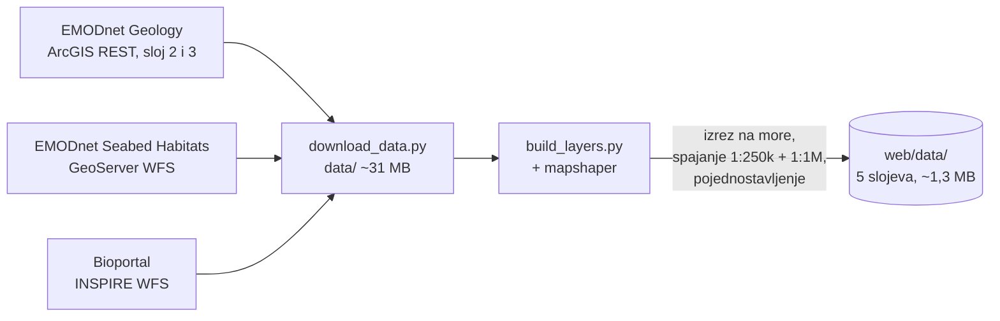

# Tehnička arhitektura

Sigurno sidrište spaja pet javnih izvora podataka u jednu odluku: *smijem li ovdje sidriti i koliko lanca trebam*. Isti mehanizam ocjene (`web/core.js`) koriste web aplikacija, REST API i MCP server za AI asistente.

## 1. Komponente

| Dio | Datoteke | Uloga |
|---|---|---|
| Sučelje | `web/index.html`, `web/app.js`, `web/style.css` | Karta (Leaflet), pretraga, popis sidrišta, detalji; mobilni prikaz kao donji izbornik |
| Mehanizam ocjene | `web/core.js` | Ocjena točke, pretraga mreže, zaklon, geokodiranje. Radi u Nodeu i u pregledniku |
| HTTP rukovatelji | `server/handlers.js`, `server/engine.js` | Provjera ulaza, API i MCP; učitava slojeve s diska |
| Vercel funkcije | `api/find.js`, `api/check.js`, `api/geocode.js`, `api/mcp.js` | Tanki omotači oko `handlers.js` |
| Lokalni server | `server/index.js` | Isto što i Vercel, na `localhost:5173` |
| MCP | `mcp/tools.js`, `mcp/stdio.js` | Alati `pronadi_sidriste` i `provjeri_tocku`; stdio i HTTP |
| Priprema podataka | `scripts/download_data.py`, `scripts/build_layers.py` | Preuzimanje i obrada slojeva (jednom, ne pri svakom zahtjevu) |

## 2. Tok podataka

### Priprema (jednom, `npm run data`)

1. **Dno:** karta 1:250k je glavna. Gdje ona ne pokriva (unutarnje uvale), rupe popunjava karta 1:1M. Folk-5 klase se prevode u ocjenu držanja 0–3.
2. **Morska trava, posidonija, biološke zone i Natura 2000** izrezuju se na hrvatsko more.
3. Rezultat je 5 GeoJSON datoteka koje se poslužuju statično i učitavaju u memoriju funkcije.

### Zahtjev „Pronađi sidrište“

## 3. Algoritam ocjene

Ocjena je pravilo s bodovima (0–100). Nije strojno učenje, pa je svaki rezultat moguće objasniti, a svaka činjenica u odgovoru ima svoje objašnjenje.

| Provjera | Izvor | Pravilo |
|---|---|---|
| Dno | EMODnet Geology | Početna ocjena: pijesak 100, mulj i miješano 82, šljunak 55, stijene 20 |
| Morska trava | EMODnet Seabed Habitats | Kartirana livada → **„Ne sidri ovdje“** (ocjena najviše 10). Infralitoral bez karte → −8 i upozorenje |
| Dubina | EMODnet Bathymetry | <2 m blokira; 2–3 m −12; 15–25 m −22; 25–35 m −35; >35 m blokira. Bez izmjere koristi se izglađena procjena (označena s ≈) |
| Vjetar | Open-Meteo | Udari ≥20 kn ili ≥25 kn u idućih 12 h → −12; ≥30/35 kn → −30 |
| Valovi | Open-Meteo Marine | ≥0,8 m −5; ≥1,5 m −15 |
| Zaklon | Profili dubine u 8 smjerova, 2 km | Kopno unutar 1,5 km = zaklon s te strane. Otvoreno prema najjačem vjetru idućih 12 h: −20 (udari ≥15 kn) ili −30 (≥25 kn) |
| Natura 2000 | Bioportal | Samo informacija, bez bodova |
| Lanac | izračun | (dubina + 1,5 m) × 5, ili × 7 kad puše |

Presuda: ≥70 „Dobro mjesto“, 45–69 „Sidri uz oprez“, <45 „Loše mjesto“, a blokada daje „Ne sidri ovdje“.

## 4. Izvori podataka i licence

| Izvor | Nositelj | Pristup | Licenca / uvjeti |
|---|---|---|---|
| EMODnet Geology – sediment dna 1:250k i 1:1M | EU (EMODnet, GTK) | ArcGIS REST, preuzeto | CC BY 4.0 |
| EMODnet Seabed Habitats – morska trava 2025, Art. 17 stanište 1120, EUSeaMap 2025 | EU (EMODnet); izvorni podaci UNEP-WCMC, države članice | OGC WFS, preuzeto | CC BY 4.0, uz navođenje izvornih nositelja |
| EMODnet Bathymetry – dubina i profili | EU (EMODnet) | REST, uživo; WMS za sjenčanje karte | CC BY 4.0 |
| Natura 2000 – područja za ptice | Ministarstvo zaštite okoliša i zelene tranzicije (Bioportal) | INSPIRE WFS, preuzeto | Javni INSPIRE servis; uvjete ponovne uporabe treba potvrditi s nositeljem |
| Vjetar, udari, valovi | Open-Meteo (modeli nacionalnih meteoroloških službi) | REST, uživo | Podaci CC BY 4.0; besplatni API samo za nekomercijalnu uporabu |
| Geokodiranje | OpenStreetMap Nominatim | REST, uživo | ODbL; najviše 1 zahtjev u sekundi, obavezan User-Agent |
| Podloga karte | OpenStreetMap, OpenSeaMap | XYZ pločice | ODbL / CC BY-SA; pravila korištenja OSM pločica |

Atribucija izvora prikazana je u aplikaciji (na karti i ispod detalja svakog mjesta) i u README-u. Korištene biblioteke: Leaflet (BSD-2-Clause), Turf (MIT), MCP SDK (MIT), zod (MIT).

## 5. Standardi i interoperabilnost

- **Ulaz:** OGC WFS 1.0/2.0, OGC WMS, ArcGIS REST, INSPIRE (Protected Sites), REST/JSON.
- **Izlaz:** GeoJSON (RFC 7946, WGS84) za slojeve; REST/JSON API opisan u [OpenAPI 3.1](../web/openapi.json) (javno na `/openapi.json`); **Model Context Protocol** (JSON-RPC 2.0 preko Streamable HTTP ili stdio) za AI asistente.
- **Koordinate:** EPSG:4326 svugdje.
- **Jezik:** sav sadržaj odgovora je na hrvatskom; kodovi (`lvl`, `id`) su stabilni i neovisni o jeziku, pa se sučelje može prevesti bez promjene API-ja.

## 6. Integracija s postojećim sustavima

Zahvaljujući REST API-ju i OpenAPI opisu, rješenje se bez promjena može ugraditi u druge aplikacije. Uz razumne prilagodbe moguće je i sljedeće:

| Sustav | Što donosi | Prilagodba |
|---|---|---|
| Hrvatski hidrografski institut (HHI) – službene karte i batimetrija | Preciznija dubina uz obalu od EMODnet mreže (~115 m) | Novi izvor u `depthAt()`; potreban sporazum o korištenju podataka |
| DHMZ – pomorska prognoza i upozorenja | Službena upozorenja za buru i jugo | Dodatna činjenica u `assess()` |
| Javne ustanove parkova i županije – koncesionirana sidrišta, polja plutača, zone zabrane sidrenja | Lokalna pravila i plutače kao preporuka umjesto sidrenja | Novi GeoJSON sloj u `scripts/` i provjera u `assess()` |
| Portal otvorenih podataka (data.gov.hr) | Objava pripremljenih slojeva kao otvorenog skupa podataka | Slojevi su već u GeoJSON formatu |
| Charter i nautičke aplikacije | Provjera sidrišta unutar postojeće aplikacije | Poziv `/api/check` ili `/api/find` |
| AI asistenti | Pitanja prirodnim jezikom | Već radi preko `/mcp` |

## 7. Preduvjeti

**Tehnički**
- Node.js ≥ 20; Python 3.8+ i `npx mapshaper` samo za pripremu podataka.
- Bez baze podataka i bez tajnih ključeva: svi izvori su otvoreni.
- Hosting: bilo koji Node server ili serverless platforma (trenutno Vercel, funkcije do 60 s).
- Za veći promet: zajednička predmemorija (npr. Redis) umjesto memorije pojedine instance, vlastita Nominatim instanca ili komercijalni geokoder, komercijalni Open-Meteo plan.

**Organizacijski**
- Vlasnik koji održava aplikaciju i jednom godišnje osvježava slojeve (EMODnet izlazi s novim izdanjima).
- Stručna provjera pravila ocjene s nautičarima i morskim biolozima (npr. udruga Sunce, JU parkova).
- Kanal za prijavu pogrešaka u podacima (npr. neoznačena livada posidonije).

**Pravni**
- Atribucija izvora prema CC BY 4.0, ODbL i CC BY-SA (već prikazana).
- Potvrda uvjeta ponovne uporabe Natura 2000 podataka s Bioportala.
- Komercijalna uporaba zahtijeva plaćeni Open-Meteo plan i drugi geokoder.
- Izjava o odricanju odgovornosti: aplikacija je pomoć pri planiranju, ne zamjenjuje službene pomorske karte, dubinomjer ni lokalna pravila.
- Privatnost: aplikacija ne traži prijavu, ne sprema osobne podatke ni lokacije korisnika i ne koristi kolačiće za praćenje.
- Kod projekta je pod licencom MIT ([LICENSE](../LICENSE)); licence izvora podataka vrijede neovisno o njoj.

## 8. Ograničenja

- Prva pretraga u novom području traje 8–15 s (dubine se mjere uživo); ponovljena je brza dok je instanca aktivna.
- Ovisnost o dostupnosti EMODnet, Open-Meteo i Nominatim servisa; pozivi su ograničeni (6 istodobnih po servisu), ponavljaju se do 3 puta i pamte 15–30 min.
- Karte dna (1:250k, 1:1M) i posidonije su grube i nepotpune za male uvale, pa aplikacija uvijek savjetuje provjeru dna i dubinomjera.
- Lokalne zabrane sidrenja (npr. u nacionalnim parkovima) još nisu uključene.
