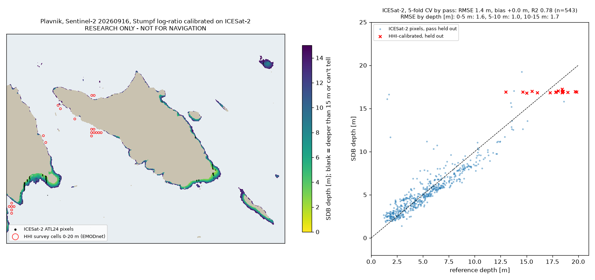

# Satelitska batimetrija (SDB) oko Plavnika: istraživački prototip

**Zaključak: kao broj dubine za sidrenje još ne prikazivati.** Kalibracija na laserskim
mjerenjima satelita ICESat-2 daje dobru točnost: RMSE oko 1.5 m na 0–15 m, a na 5–10 m oko 1 m.
Ostaju opasne pogreške: oko 3 % piksela satelit procijeni najmanje 2 m dublje nego što jest,
a nekoliko i preko 5 m, uglavnom na 0–5 m. U demo prezentaciji može poslužiti kao jasno označen
eksperimentalni sloj „ovdje je plićak”, ne kao dubina. Takav sloj za cijelu obalu izrađuje
`sdb_hr.py` (odjeljak [Cijela obala](#cijela-obala-sloj-pliće-od-4-m)).



## Metoda

1. **Snimka:** Sentinel-2 L2A, kanali B02 (plavi), B03 (zeleni) i B08 (NIR), 10 m.
   Uzeta je s javnog Element84 Earth Search STAC-a (bucket `sentinel-cogs` na AWS-u, bez prijave).
   Od 42 snimke s manje od 3 % oblaka (05/2025–11/2026) izabrane su dvije s najmanje odsjaja (glinta):
   - glavna: `S2B_33TVK_20260916_0_L2A`;
   - kontrolna: `S2A_33TVK_20250918_1_L2A`.

   Earth Search je već skinuo L2A pomak (`earthsearch:boa_offset_applied`), pa je refleksija = DN·1e-4.
   Ako se primijeni i `offset: -0.1` iz STAC-a, voda ispadne negativna.
2. **Maska kopna i omjer:**
   - piksel je kopno ako je B08 > 0.02;
   - prvi vodeni piksel uz obalu se odbacuje (miješani pikseli);
   - omjer je Stumpfov `ln(1000·B02) / ln(1000·B03)`, zatim medijan na 5×5 piksela (50 m).
3. **ICESat-2 ATL24** (NASA/NSIDC, obalna batimetrija iz fotona ATL03, s korekcijom loma svjetla):
   - Dohvaćeno je preko javnog servisa SlideRule Earth (`atl24x`, bez Earthdata prijave):
     153 prolaza i snopa, 2018-10 do 2026-04.
   - Dubina = `surface_h − ortho_h`.
   - Koriste se samo fotoni pouzdanosti ≥ 0.9. Uz 0.5 ili 0.7 ulazi puno lažnih „dna”
     i korelacija padne na 0.3 odnosno 0.7.
   - **Lažna dna:** i uz 0.9 ATL24 vraća pojedinačne „dna” na 8–16 m iznad mora koje HHI multibeam
     mjeri na 40–80 m. Fotoni u ćelijama gdje HHI premjer kaže > 30 m zato se odbacuju
     (51 foton u 19 ćelija).
   - Za svaki 10 m piksel uzima se medijan dubine, ako u pikselu ima barem 3 fotona.
4. **Provjera:** unakrsna provjera u 5 dijelova, **grupirano po prolazu** (datum + snop).
   Svaki prolaz je cijeli ili u treningu ili u testu, pa susjedni fotoni istog prolaza ne „cure” u test.
5. **Granica optički duboke vode:** 10. percentil omjera u ćelijama dubljim od 50 m.
   Karta prikazuje samo 0–15 m: tek 7 % kalibracijskih piksela je dublje od 10 m.
6. **Usporedba:** isti omjer kalibriran je i na EMODnet ćelijama iz pravog premjera.
   - `Pula_Rijeka_Cres_Dubrovnik` je premjer Hrvatskog hidrografskog instituta (HHI),
     DTM 225 m. Izvor svake ćelije dohvaća se preko EMODnet REST-a.
   - `croatia2003` **nije premjer**, nego EOMAP-ova satelitska batimetrija iz Sentinel-2 (2019).
   - GEBCO2024 je globalna popuna.

## Rezultati

### Kalibracija na ICESat-2 (glavni rezultat)

| | 2026-09-16 | 2025-09-18 |
|---|---|---|
| fotona / piksela / prolaza | 6993 / 543 / 49 | 6993 / 538 / 51 |
| dubine kalibracije (p10 / p50 / p90) | 2.1 / 4.9 / 9.1 m | 2.2 / 5.0 / 9.1 m |
| Pearson r (omjer vs. dubina) | 0.89 | 0.86 |
| **CV po prolazima: RMSE / bias / R²** | **1.4 m / +0.1 m / 0.78** | **1.6 m / −0.0 m / 0.73** |
| MAE, 95. percentil apsolutne pogreške | 0.9 m, 2.0 m | 1.1 m, 2.4 m |
| 0–5 m: RMSE / bias (n) | 1.6 m / +0.5 m (276) | 1.9 m / +0.4 m (271) |
| 5–10 m: RMSE / bias (n) | 1.0 m / −0.4 m (226) | 0.9 m / −0.3 m (226) |
| 10–15 m: RMSE / bias (n) | 1.8 m / −0.8 m (38) | 1.8 m / −1.6 m (38) |
| **SDB dublje od stvarnog za > 2 m / > 5 m** | **16 / 4 piksela** | **19 / 3 piksela** |
| nagib / odsječak | 25.4 / −21.2 | 28.5 / −23.3 |

Kako čitati brojke:

- **Najbolje je na 5–10 m:** pogreška je oko 1 m, uz malu sklonost prema plićem
  (sigurniji smjer za nautičara).
- **Na 0–5 m procjena je u prosjeku za pola metra preduboka.** Model teško ide ispod oko 2 m.
  Nekoliko piksela sa stvarnih 1.5–2 m procijenjeno je na 11–17 m: tamno dno, sjena ili miješani
  piksel uz obalu. To je baš pogreška koja nasuče brod.
- **Dvije snimke daju sličnu točnost**, ali različite koeficijente. Svaka snimka zato treba
  vlastitu kalibraciju, što je uz ICESat-2 izvedivo automatski.
- **Pokrivenost je ograničena.** ICESat-2 prolazi su uglavnom na južnoj obali Plavnika
  i na vrhu Cresa (crne točke na karti). Model nije provjeren na sjevernoj obali Plavnika,
  koja je strma i prema karti brzo prelazi 15 m.

### Kalibracija samo na EMODnet premjeru (prvi pokušaj, ne radi)

- **Premalo i preduboko:** na 0–20 m ima samo 54 HHI ćelije (od 3293), medijan 17.7 m,
  samo 2 pliće od 13 m.
- **Iza optičke granice:** njih 49 je dublje nego što satelit razlikuje od otvorenog mora.
- **Model nema moć:** r = 0.04–0.10. Na izdvojenih 30 % RMSE je 2.0–2.1 m, ali R² je −0.08
  do −0.25, jer model vraća konstantu oko 17 m.
- **Kalibracija na EOMAP-u:** provjerena na HHI premjeru, RMSE je 4.1–4.7 m, R² < 0.

### Što ICESat-2 kaže o EMODnetu oko Plavnika

Usporedba po ćelijama, samo gdje ICESat-2 mjeri 0–20 m. Bias = EMODnet − ICESat-2.

| EMODnet izvor | ćelija | RMSE | bias |
|---|---|---|---|
| `croatia2003` (EOMAP SDB) | 85 | 3.9 m | **+2.1 m** (EMODnet dublji od stvarnog) |
| bez izvora (obalni rub) | 43 | 6.1 m | −4.8 m |
| GEBCO2024 | 5 | premalo za zaključak | |
| HHI premjer | 0 | svih 19 HHI ćelija s ICESat-2 „dnom” bila su lažna dna (> 30 m) | |

Za aplikaciju je ovo važno. Uz samu obalu, gdje se sidri, EMODnet je ili EOMAP-ova satelitska
procjena koja je u prosjeku 2 m preduboka, ili rub bez podataka.

### Prag za sloj „pliće od 4 m”

Sloj na karti odgovara na pitanje „je li ovdje pliće od 4 m?”. Uz prag od 4 m satelit promaši
petinu stvarnih plićaka, pa se označava sve gdje SDB procjenjuje manje od **5 m** (1 m rezerve).
Za cijelu obalu prag se bira po bloku (vidi niže).

Provjera na ICESat-2 pikselima iz izdvojenih prolaza, snimka 2026-09-16:

| prag na SDB | uhvaćeno stvarnih < 4 m | označeno koje je stvarno < 4 m |
|---|---|---|
| < 4 m | 78 % | 88 % |
| **< 5 m (korišteno)** | **96 %** | **70 %** (ostalo je 4–6 m) |
| < 6 m | 99 % | 56 % |

## Cijela obala: sloj „pliće od 4 m”

`sdb_hr.py` ponavlja istu metodu za cijeli hrvatski dio Jadrana i izrađuje web pločice
`web/tiles/sdb/{z}/{x}/{y}.png` (z 8–13) s `index.json`. U aplikaciji je to prekidač
„Pliće od 4 m sa satelita (eksperimentalno, dio obale)”. Rezultati po pločici i bloku su
u `results_hr.json`.

### Postupak

1. **Područje:** 17 Sentinel-2 pločica (MGRS) preko hrvatskog gospodarskog pojasa
   (Marine Regions EEZ, mrgid 5673; poligon uključuje i unutarnje vode).
2. **Snimka po pločici:** od snimaka s < 5 % oblaka (05/2025–11/2026) uzima se ona s najmanjim
   NIR-om nad otvorenim morem (najmanje glinta).
3. **Omjer samo za obalno more:** do 3 km od kopna ili gdje EMODnet kaže pliće od 40 m.
   Ostalo je isto kao za Plavnik: maska kopna, odbačen prvi piksel uz obalu, Stumpfov omjer, medijan 5×5.
4. **ICESat-2 ATL24 po pločici** (SlideRule, 3×3 upita zbog ograničenja od 300 granula).
   Lažna dna: fotoni gdje EMODnet kaže dublje od 40 m se odbacuju.
5. **Kalibracija po blokovima od 15 km.** Jedan model za cijelu pločicu (110 km) miješa vrste dna
   i prozirnost mora. Na pločici 33TVK jedan model ima r 0.39, a većina blokova od 15 km oko 0.9.
   Veličina bloka odabrana je na 33TVK (prije usporedbe s EMODnetom, koja na 33TVK ništa ne mijenja):

   | blok | prolazi provjeru | označeno |
   |---|---|---|
   | 20 km | 12 / 28 | 24.7 km² |
   | **15 km** | **17 / 50** | **32.1 km²** |
   | 10 km | 21 / 88 | 31.5 km² |

6. **Provjera svakog bloka.** Blok se crta samo ako prođe sve uvjete:
   - barem 80 ICESat-2 piksela iz barem 8 prolaza;
   - CV po prolazima: r ≥ 0.7 i RMSE ≤ 2 m;
   - barem 20 piksela stvarno plićih od 4 m;
   - postoji prag SDB-a ≤ 6 m (korak 0.5 m) koji uhvati ≥ 95 % stvarnih plićaka < 4 m
     (iz izdvojenih prolaza). Taj prag se koristi za crtanje;
   - **usporedba s EMODnetom:** najviše 10 % označene površine smije biti gdje EMODnet kaže
     dublje od 20 m. Piksel gdje EMODnet kaže > 20 m se nikad ne označava.
7. **Web pločice:** zoom 13 (~14 m piksel) s `max` preuzorkovanjem, zatim 2×2 `max` prema manjim
   zoomovima. Gdje se Sentinel-2 pločice preklapaju, piksel je označen ako ga označi bilo koja.

Zašto usporedba s EMODnetom: provjera na ICESat-2 vidi samo mjesta gdje ICESat-2 nalazi dno,
a to je uz obalu. Na pločici 33TVL dva bloka su prošla CV (RMSE 1.1–1.3 m), ali su označila
28 km² mora dubokog 30–60 m zapadno od Krka (82–86 % označenog). Razlika od 16+ m je daleko
veća od pogreške EMODneta uz obalu (~2 m), pa je to pouzdan znak lošeg modela.

### Rezultat

**28 od 325 blokova prolazi provjeru**, u 6 od 17 pločica. Označeno je oko 50 km² mora
(zbroj po pločicama, preklapanja brojena dvaput). Web pločice zauzimaju 1.7 MB (430 datoteka).

| | blokova |
|---|---|
| prošlo | 28 |
| premalo ICESat-2 (< 80 piksela ili < 8 prolaza) | 242 |
| loša kalibracija (r, RMSE, premalo plićaka ili nema praga) | 50 |
| previše označenog gdje EMODnet kaže > 20 m | 5 |

U blokovima koji su prošli CV RMSE je 0.8–2.0 m (medijan 1.3 m). Prag je 4.0–6.0 m
(najčešće 4.5 m), uhvati 95–100 % stvarnih plićaka < 4 m, a od označenog je 30–90 %
stvarno pliće od 4 m (ostalo je uglavnom 4–6 m).

**Gdje sloj postoji:** zapadna i južna Istra (Umag, Rovinj, Medulin), Kvarner (Cres, Lošinj,
Krk, Rab, Pag), sjeverna Dalmacija do Zadra, Pašmanskog kanala i Murtera, i jedan blok kod Visa.

**Gdje ga nema:** srednja i južna Dalmacija (Split, Hvar, Korčula, Mljet, Dubrovnik). Tamo je
obala strmija, a ICESat-2 nalazi dno na premalo mjesta: na pločici 33TXH (Hvar, Korčula, Pelješac)
ima 2 664 piksela s dnom u 40 blokova, i nijedan blok ne prolazi. Na Plavniku blok prolazi
(r 0.92, RMSE 1.4 m), ali je obala strma, pa je označeno malo.

## Ograničenja

- **Tamno dno** (posidonija, alge, tamna stijena) čita se kao dublje. ICESat-2 dno nalazi
  uglavnom na svijetlom pijesku, pa je stvarna pogreška nad posidonijom vjerojatno veća
  od izmjerene.
- **Glint, valovi, brodski tragovi i mutnoća** (kiša, bujice, plankton) mijenjaju omjer neovisno
  o dubini. Svaka snimka treba svoju kalibraciju.
- **ICESat-2 nije savršen:**
  - lažna dna uklanjamo samo tamo gdje HHI premjer kaže suprotno;
  - vertikalna pogreška ATL24 je red veličine 0.3–1 m;
  - mjerenja su iz 2018–2026, a dno se uz obalu malo mijenja.
- **Optička granica je oko 18–21 m** po modelu, ali je kalibrirano tek do oko 12 m.
  Karta zato staje na 15 m.
- **Plima** (oko 0.3–0.5 m na Kvarneru) nije korigirana ni u snimci ni u ICESat-2.
- **Isti teren:** prolazi se dijele na trening i test, ali svi leže na istih nekoliko obala.
  Prenošenje na druga sidrišta treba provjeriti posebno.

## Što dalje

1. **Neovisna provjera na plićini:** zapis dubinomjera s plotera tijekom jedne plovidbe oko
   Plavnika. To jedino može potvrditi 0–5 m.
2. **Maska posidonije** (npr. karta staništa Natura 2000 ili klasifikacija iz same snimke) i kompozit
   više snimaka prije regresije.
3. **Isti postupak na drugim sidrištima.** ICESat-2 ATL24 pokriva cijeli Jadran, pa je postupak
   automatski ponovljiv.

## Pokretanje

```bash
python3 -m venv .venv-sdb && .venv-sdb/bin/pip install numpy rasterio matplotlib sliderule
.venv-sdb/bin/python research/sdb/sdb_plavnik.py            # obje snimke
.venv-sdb/bin/python research/sdb/sdb_plavnik.py S2B_33TVK_20260916_0_L2A
```

Prvo pokretanje traje oko 10–15 minuta. Skida izreze snimaka (~25 MB) i ICESat-2 fotone
(SlideRule, ~1 min). EMODnet REST pita za izvor ~3600 ćelija, sekvencijalno, da ne udari u 429.
Sve se sprema u `research/sdb/data/`, što git ignorira. Izlazi su `sdb_plavnik.png`
(prva snimka) i `results.json` (obje snimke i usporedba s EMODnetom).

Cijela obala (uz `scipy` i `shapely`):

```bash
.venv-sdb/bin/pip install scipy shapely
.venv-sdb/bin/python research/sdb/sdb_hr.py --prefetch 33TUK 33TVK   # samo dohvat u cache (može paralelno)
.venv-sdb/bin/python research/sdb/sdb_hr.py                          # kalibracija i web pločice
```

Dohvat ICESat-2 traje ~10 min po pločici, pa se `--prefetch` isplati pokrenuti u 3 procesa.
Prvi put ukupno ~1 h. Cache je u `research/sdb/data/hr/`. Pokretanje s popisom pločica
preračuna samo njih, a ostale uzme iz prethodnog `results_hr.json`.

## Izvori podataka i licence

- **Sentinel-2 L2A:** sadrži izmijenjene podatke Copernicus Sentinel [2025, 2026]
  (ESA/EU Copernicus, slobodna i otvorena licenca). Dohvaćeno preko Element84 Earth Search /
  AWS Open Data `sentinel-cogs`.
- **ICESat-2 ATL24** (*ATLAS/ICESat-2 L3A Along Track Coastal and Nearshore Bathymetry*,
  NASA NSIDC DAAC, V002): NASA podaci bez ograničenja korištenja, uz citiranje.
  Dohvaćeno preko SlideRule Earth (University of Washington / NASA).
- **EMODnet Bathymetry DTM 2024:** EMODnet Bathymetry Consortium, CC BY 4.0. Uključuje premjere
  Hrvatskog hidrografskog instituta (oznaka *Not for Navigation*), EOMAP SDB `croatia2003`
  i GEBCO 2024 kao popunu (GEBCO Compilation Group).
- **Granica područja:** Flanders Marine Institute (VLIZ), *Maritime Boundaries Geodatabase*,
  marineregions.org (WFS sloj `MarineRegions:eez`, mrgid 5673), CC BY 4.0.
- **Metoda:**
  - Stumpf, Holderied & Sinclair (2003), *Limnology and Oceanography* 48(1):547–556;
  - kalibracija ICESat-2 + Sentinel-2 prema Thomas et al. (2021), *Geophysical Research Letters* 48(6), e2020GL092170.
